<p align="center">
  
</p>

<h1 align="center">Sagax</h1>

<p align="center">
  <strong>Your AI teammates, in a chat app.</strong><br>
  Each bot has its own engine, its own computer and a mascot of its own.<br>
  Nothing that matters happens without your approval.
</p>

<p align="center">
  <a href="https://github.com/pulsatrixtechnologies/sagax/releases"></a>
  
  <a href="#license"></a>
</p>

<p align="center">
  <a href="#download">Download</a>
  &middot;
  <a href="#why-sagax">Why Sagax</a>
  &middot;
  <a href="#what-your-bots-can-do">Features</a>
  &middot;
  <a href="#a-server-of-your-own">Self-host</a>
  &middot;
  <a href="#documentation">Docs</a>
  &middot;
  <a href="https://pulsatrix.ca">Website</a>
</p>

---

<p align="center">
  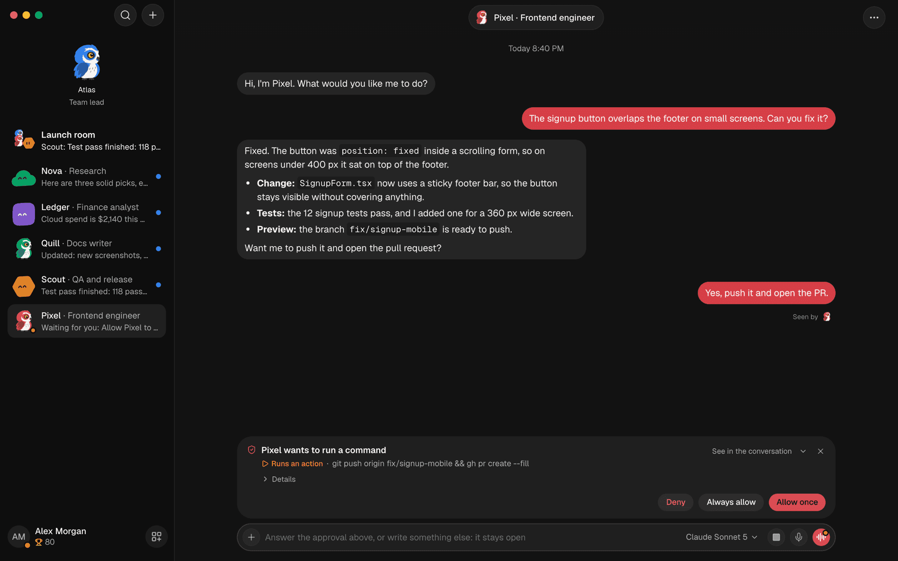
</p>

Sagax is a desktop and mobile app where your contacts are AI agents. Each
bot runs a real agent engine, such as Claude Code, Codex or Grok, with its
own name, personality, model, memory, routines and computer. Talk to one bot,
put several in a group with your colleagues, call one, and watch them work.

Bots do real work: they run commands, edit files, browse the web, fill forms,
shop, publish pages and use apps. Anything that matters waits for you on an
approval card in the chat, and you decide how much each bot may do on its own.

## Why Sagax

- **Bring your own engine.** Claude Code, Codex, Grok, Cursor, OpenCode,
  Gemini, any ACP command line agent, an OpenAI compatible endpoint or a
  local model. Sign in with the subscription you already pay for.
- **Auto picks the model.** One brain per bot, and the right model per task:
  a short question runs on a fast model, code and long reads keep the main
  one, and workers get the best model for their job.
- **Your Grok and Claude connectors, in every bot.** Mail, calendar, Teams and
  the rest reach your bots through the account that has them.
- **A computer for every bot,** and a browser that works out of sight. The
  screen is used only when you ask, and it is always announced with a Stop
  button.
- **Approvals you control,** in plain words. Allow, deny or answer from a
  card; write rules such as "never send email without me"; give a trusted bot
  full access.
- **Yours, on your machine.** No account for solo use, no telemetry, a
  credential vault on your keychain, and conversations encrypted at rest.

## What your bots can do

Every capture below comes from the app itself, on invented bots and
content, in the Studio theme (dark) with the owl and the shapes as mascots.

### The chat and its cards

Each bot keeps a single running conversation; **New topic** starts fresh
context while earlier topics stay one scroll up. Send a message and a
working line shows what the bot is doing until its answer streams in. The
composer stays free while the bot works: a message sent mid-turn gets its
own reply once the current one is done, and "wait" stops it right away.
Drag a bot, a group or a thread onto the conversation to open it beside the
main chat.

<p align="center">
  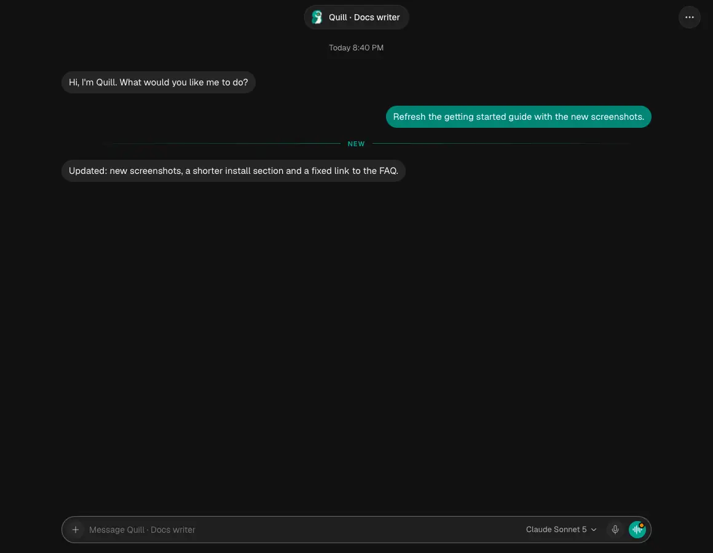
</p>

When a bot needs you, its question or approval is a card pinned above the
composer, with the choices on it: **Deny**, **Always allow** or **Allow
once**. Answer it and the card folds into one line of the conversation while
the bot carries on. Questions, sign-in requests, purchases and phone calls
are cards too.

<p align="center">
  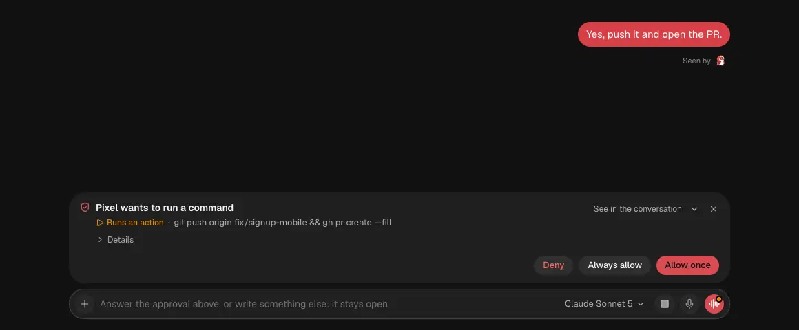
</p>

### Bots, their page and their mascot

A bot's page fills the main area: its appearance on top (mascot, colour and
skin, with a live preview), then rows that each open a sub-page:
instructions, memory, skills, routines, library and sharing, and a Stats tab
with usage by account, model, source and person. Every bot wears a
character: the owl, the crab, the Shapes, and the ones your achievements
unlock. Characters move while the bot thinks, works, waits or sleeps, on the
desktop, on your phone and in your notifications.
([mascots](docs/mascots.md), [achievements](docs/achievements.md))

<p align="center">
  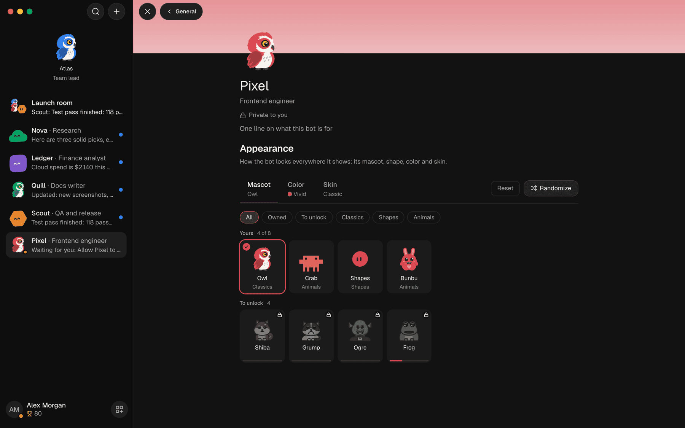
</p>

<p align="center">
  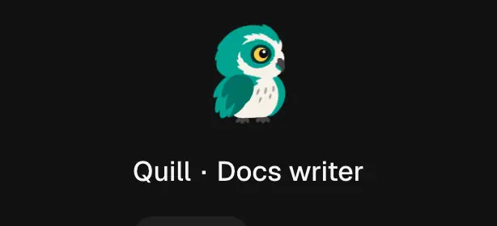
</p>

### Routines and their runs

Run work once, on weekdays, every few minutes, when a webhook or an email
arrives, when a GitHub issue is opened or labeled or a review is requested,
or only when a file or a command's output changes. Sort routines into
folders; a routine that fails several times pauses itself. A fixed-time
reminder costs nothing: no model turn, just the message. Run one now from its
page and the run lands under **Runs**, with its result in the conversation.
Every run is on the Automations calendar.
([schedules](docs/routine-schedules.md), [folders](docs/routine-folders.md))

<p align="center">
  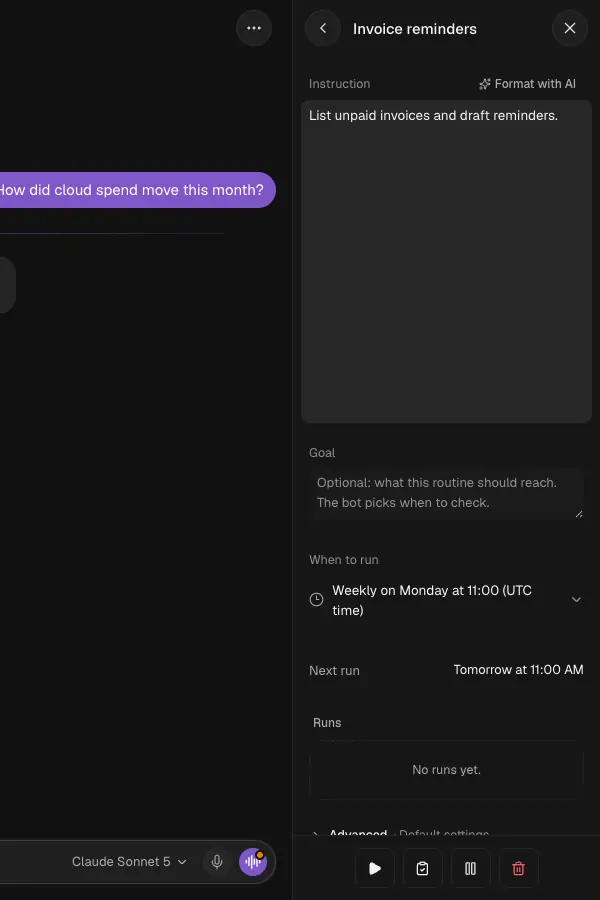
</p>

<p align="center">
  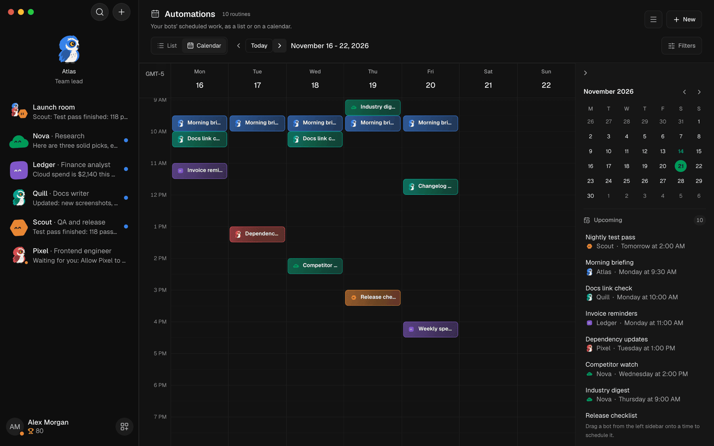
</p>

### Models, providers and Connect apps

The model menu in the chat bar goes in two steps: **Auto** (the best model
per task) or the bot's own model, then a provider and its models. Settings >
Providers shows the accounts your bots use, what is signed in and what needs
setup; an engine signs in from the app. Settings > Models sets the model of
every bot in one table. **Connect Apps** brings your Claude and Grok
connectors, MCP servers, plugins and skills to your bots, for everyone or
for one bot. Other AI clients can send work to your bots through Sagax's own
MCP server. ([engines](docs/custom-engines.md), [your MCP servers](docs/custom-mcp-servers.md),
[Sagax as an MCP server](docs/mcp-server.md), [teams](docs/team-sharing.md))

<p align="center">
  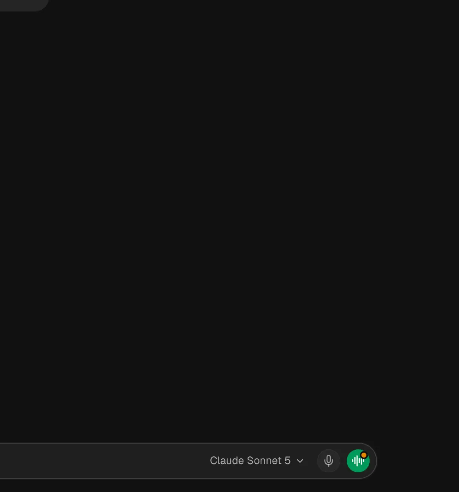
</p>

<table>
<tr>
<td width="50%" valign="top">
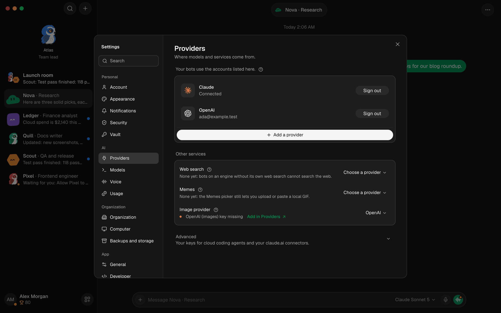
<p align="center"><sub>Settings > Providers: the accounts your bots use.</sub></p>
</td>
<td width="50%" valign="top">
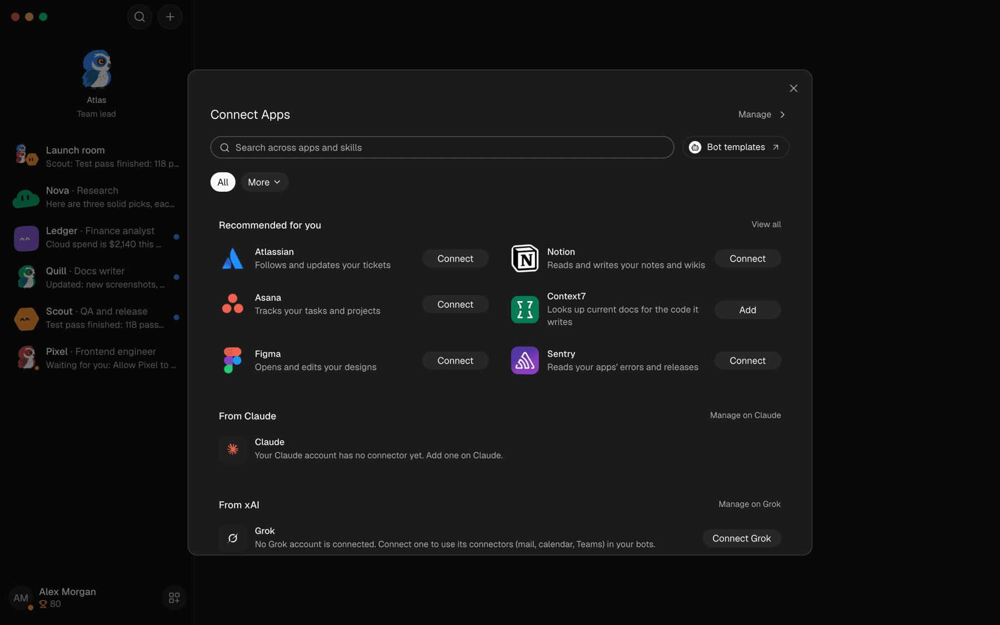
<p align="center"><sub>Connect Apps: connectors, MCP servers, plugins and skills.</sub></p>
</td>
</tr>
</table>

### Pages and the Library

A bot proposes a page in the conversation; you publish it or decline. A
published page opens with a reading bar, Share and Download PDF, and a public
link that needs no sign-in. Readers comment right in the page, and the bot
reads the comments and answers them. Files, images, archives and pages live
in each bot's Library, sorted by date, with earlier versions kept.

<table>
<tr>
<td width="72%" valign="top">
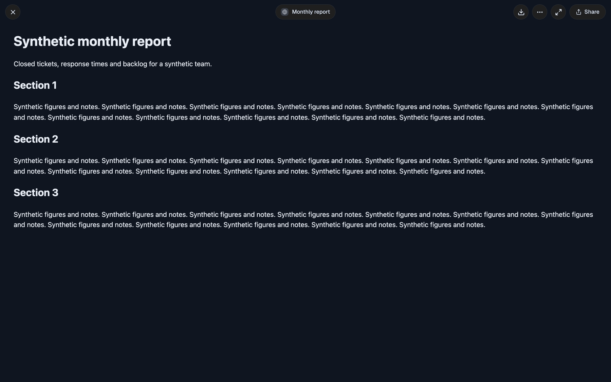
</td>
<td width="28%" valign="top">
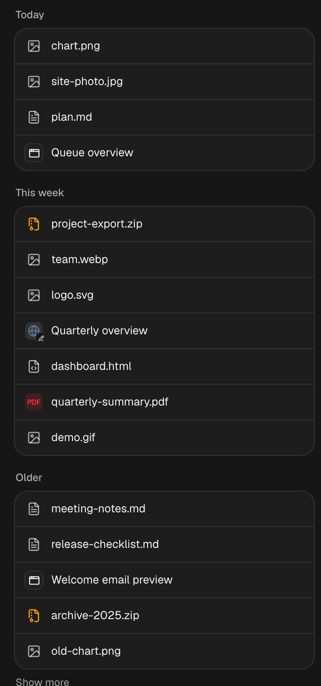
</td>
</tr>
</table>

### Skills and memory

Skills are instructions a bot loads when the task calls for them; they
revise themselves and propose their changes in one click, and the slash
menu of the composer lists them. Memory keeps what your bots learn as notes,
by bot and by tier, with a map, tags and a quality view, and recalls by
meaning, not only by words. ([memory](docs/memory.md))

<p align="center">
  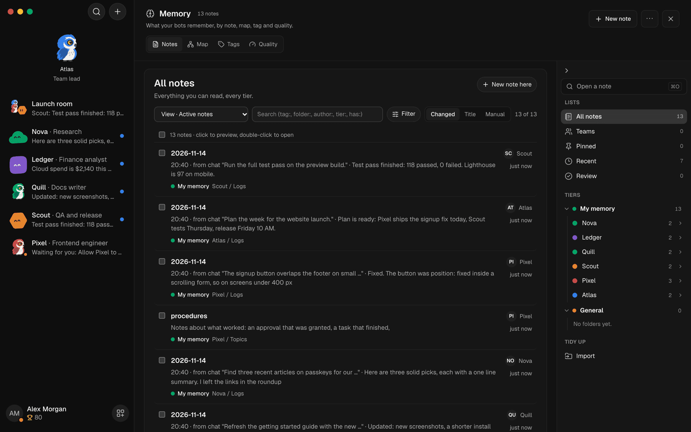
</p>

### Voice and phone calls

Call a bot and talk: the bot stays the brain, with its tools, memory and
approvals, and every sentence lands in the thread as a normal message.
Settings > Voice picks who speaks and who listens, the microphone, and the
key for live calls. Dictation and read-aloud work on the desktop and on iOS.
With a phone line, people can call your bot or text it, and a text becomes a
turn of your conversation; with **Reach me**, a bot asks its questions
outside the app. ([voice](docs/voice-mode-xai.md), [Reach me](docs/reach-me.md))

<p align="center">
  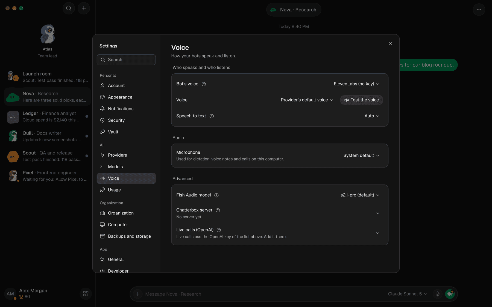
</p>

### The computer and unattended access

A bot's computer is an isolated Linux desktop on your machine (Local VM),
your own computer through computer use, or an isolated server environment;
idle desktops stop on their own. Watch the screen live and take control at
any time. Settings > Computer sets the bots' computer, the built-in browser,
and whether bots share one desktop or get one each. **My devices** lists
every Sagax install of yours, with bot access set per device, and
unattended remote access keeps a computer reachable for its bots.
([computer use](docs/computer-use-integration.md), [server environments](docs/user-sandbox.md),
[remote sessions](docs/remote-sessions.md))

<p align="center">
  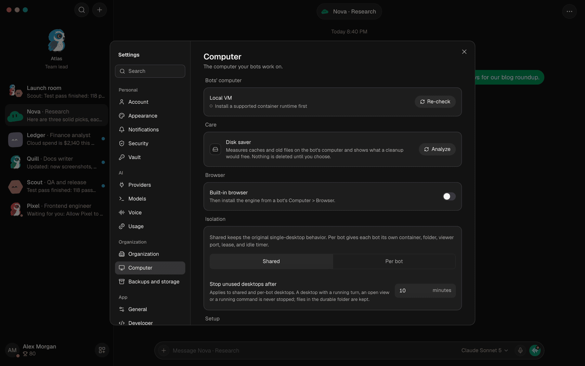
</p>

### Groups and team rooms

Mention a bot with `@` and it joins in; `stop @Bot` halts it. Give the group
a goal and the bots work toward it in the group's own conversation. Linked
to an organization, a room holds people and bots together, each person's
turns run with that person's own access, and you can leave a group you were
added to.

<p align="center">
  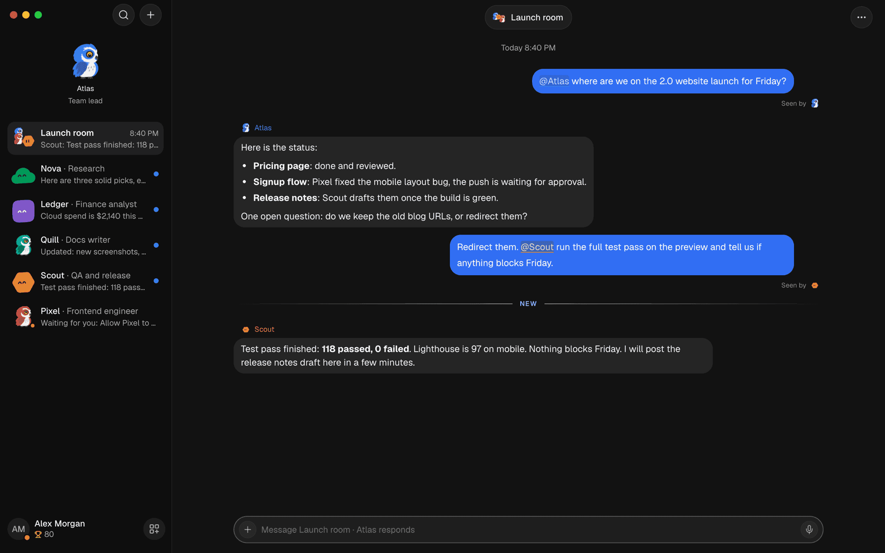
</p>

### Vault, shopping and cards

Logins, API keys and secure notes live in a vault on your system keychain;
1Password works too, read only. A bot fills a login only after you allow it,
for this turn only if you prefer, and a filled value never shows up in the
prompt or the logs. Bots shop with cards in the chat and follow up on
orders; nothing is charged until you allow it.

<table>
<tr>
<td width="50%" valign="top">
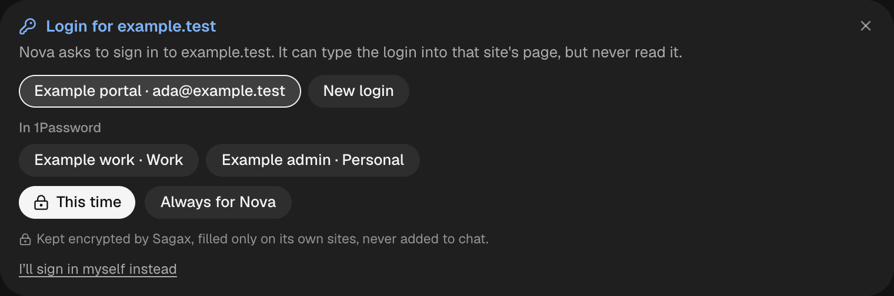
<p align="center"><sub>A bot asks before it signs in anywhere.</sub></p>
</td>
<td width="50%" valign="top">
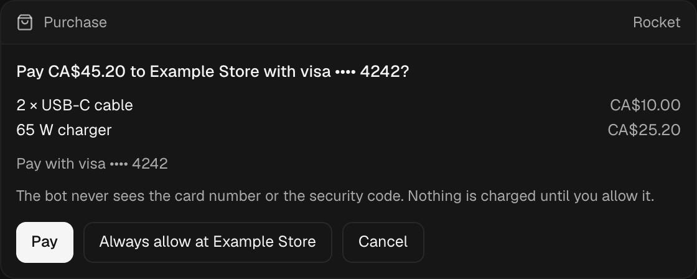
<p align="center"><sub>Purchases wait on a card too.</sub></p>
</td>
</tr>
</table>

### iPhone and iPad

Follow work, answer approvals, call your bots and manage their routines from
your phone or tablet. Each bot keeps the same single conversation as on the
desktop, and the iPad shows the desktop layout. Notifications carry the
bot's mascot. ([iOS app](docs/ios-companion.md))

<table>
<tr>
<td width="50%" valign="top">
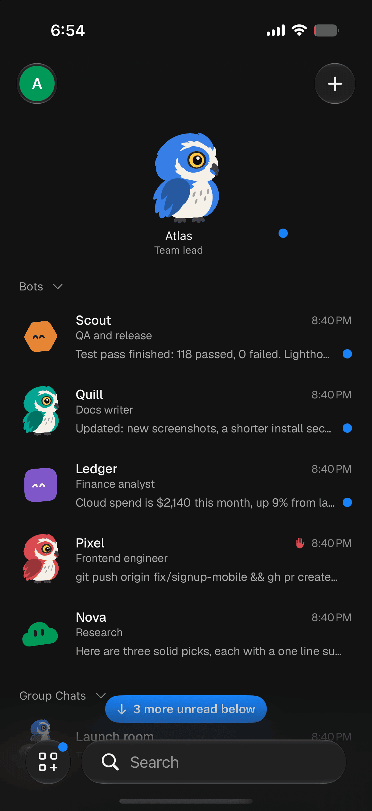
</td>
<td width="50%" valign="top">
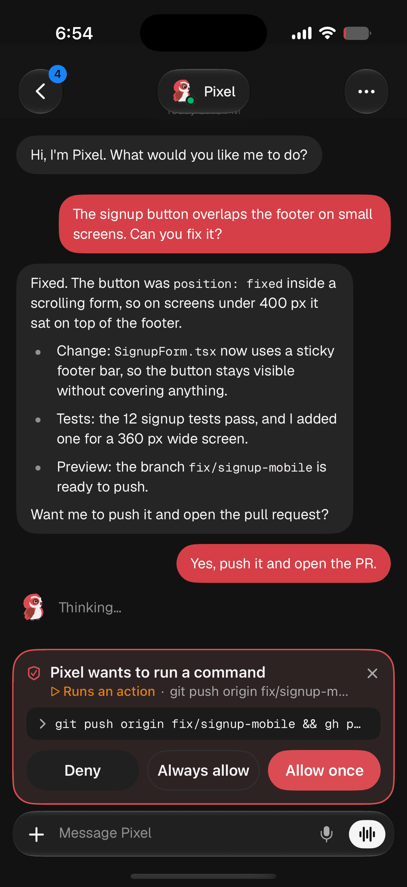
</td>
</tr>
</table>

<p align="center">
  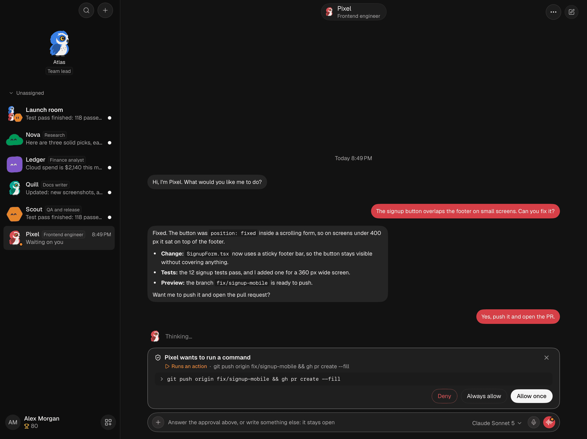
</p>

<p align="center">
  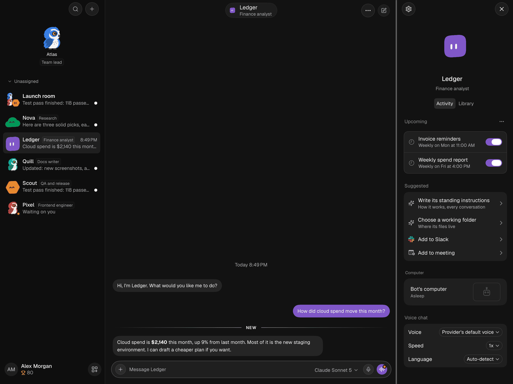
</p>

### And more

- **Rich answers.** Tables, charts with their source, diagrams, PDF and Excel
  files, interactive widgets, GIFs, video and voice notes, right in the chat.
- **Confidential threads.** A thread only its owner can read, kept out of
  search and backups. ([confidential threads](docs/confidential-threads.md))
- **Import an agent.** Start a bot from a Grok, Claude Code or Hermes agent
  you already have. ([import](docs/import-agent.md))
- **Feedback with `/feedback`.** Type it in any chat: the server reads that
  chat (what you asked, the error, the engine and model, the version), writes
  a precise GitHub issue with every name, address, ticket, path and secret
  replaced by a neutral word, shows you the exact text, and sends it.
- **Developer, when you need it.** MCP, tokens, webhooks, logs, embeddings,
  the working folder and zip export live in Settings > Developer, with
  OpenTelemetry traces, OTLP export and a usage stats API.
  ([agent API](docs/agent-api.md))
- **Headless too.** `sagax` on the command line gives a task, waits for the
  answer, backs up and restores. ([CLI](docs/cli-onboarding.md))
- **Ten languages,** including English, French, German, Spanish, Portuguese,
  Japanese and Chinese.

## Download

Get the latest build from the
[Releases page](https://github.com/pulsatrixtechnologies/sagax/releases).

| Platform | File |
|---|---|
| macOS, Apple silicon | `Sagax-X.Y.Z-arm64.dmg` |
| macOS, Intel | `Sagax-X.Y.Z-x64.dmg` |
| Windows, x64 and arm64 | `Sagax-X.Y.Z-setup.exe` (one installer for both) |
| Windows, portable | `Sagax-X.Y.Z-win-x64.zip` or `Sagax-X.Y.Z-win-arm64.zip` |
| iPhone and iPad | TestFlight beta, on invitation: write to hello@pulsatrix.ca |

- New to Sagax? The [10-minute quickstart](docs/quickstart-msp.md) takes
  you from install to a working first message.
- macOS builds are signed and notarized by Apple. The Windows installer is
  code signed; if SmartScreen still warns, choose **More info**, then
  **Run anyway**.
- Your bots need at least one engine installed and signed in, such as
  [Claude Code](https://claude.com/claude-code) or
  [Codex](https://github.com/openai/codex). Settings > Providers shows what is
  ready and helps with the rest.
- Updates come only from this repository's releases. Pre-releases are opt in,
  in Settings > Updates.

## A server of your own

The desktop app runs its own server. For a server that stays on when your
computer is off, or that several devices share, one line installs it with
Docker and prints a sign-in link ([docs/install.md](docs/install.md), or hand
[SETUP_PROMPT.md](SETUP_PROMPT.md) to your coding agent):

```sh
curl -fsSL https://raw.githubusercontent.com/pulsatrixtechnologies/Sagax/main/install.sh | bash
```

`sagax update` moves it to the next release. The server and the command
line also install from npm: `npm install -g @pulsatrixtechnologies/sagax`.
Guides: [self-hosting](docs/self-hosting.md), [a personal server on a
VPS](docs/deploy-vps.md), [Kubernetes](docs/sandbox-kubernetes.md).

## Solo or organization

Sagax asks at first launch how it should run.

**Solo (no server).** Everything stays on your computer: bots, conversations,
memory and keys live in `~/.sagax`. No account is needed.

**Organization (Sagax Business).** The app joins your organization's Sagax
server and signs you in with your browser. Bots can be shared with people and
teams, and each person who speaks to a bot pays for their own turn with their
subscription, their key or the organization's key. Bots never run on the
server itself: they work in the speaker's isolated server environment or on
the speaker's own computer through the desktop app. What stays in your own
environment is yours to set, with no administrator in the way.

Sagax Business is the organization layer: the admin console, people and
teams, sign-in, organization policies (allowed engines, approval modes,
default models), shared keys and the activity log. It is provided by
Perspicax, a separate Pulsatrix product, and it is **closed source**. The
Sagax app and its server, in this repository, are open source under the
Apache License 2.0 (see [License](#license)). A solo app that joins an
organization later can bring chosen bots along, with their conversations
and memory.

## Security and privacy

- **No telemetry.** Sagax sends no analytics. A build check fails when a
  bundle names a blocked host.
- **Encrypted at rest.** Conversations, bot memory, attachments and event
  logs are sealed with a key per person; erasing a person makes their data
  unreadable, and search still works. ([content encryption](docs/content-encryption.md))
- **Keys stay out of the model.** The app only learns whether a key is set,
  never its value. A vault key can be sent by Sagax itself, bound to its
  sites, without the model seeing it.
- **Sensitive fields masked.** Passwords, codes and card numbers are masked
  in everything the model sees, screenshots and page reads included.
- **You approve, nobody else.** Only a bot's owner can approve its actions,
  and nobody reads another person's private or confidential thread. The
  action log shows every allowed, asked, denied or failed action.
- **Sign-in in your browser,** where passkeys and password managers work.

Report a vulnerability as described in [SECURITY.md](SECURITY.md).

## Documentation

Start with [docs/](docs/): [approval levels](docs/approval-levels.md),
[engines](docs/custom-engines.md), [mascots](docs/mascots.md),
[routines](docs/routine-schedules.md), [voice](docs/voice-mode-xai.md),
[Reach me](docs/reach-me.md), [memory](docs/memory.md),
[iOS](docs/ios-companion.md), [self-hosting](docs/self-hosting.md),
[security](docs/security/), and the release notes in
[docs/releases/](docs/releases/).

## Build from source

Requirements: macOS or Windows, Node 24 or newer, pnpm, and one engine
signed in.

```sh
git clone https://github.com/pulsatrixtechnologies/sagax && cd sagax
pnpm install

pnpm dev:server    # Sagax server on 127.0.0.1:8799
pnpm dev           # the app in a browser, http://127.0.0.1:5199
pnpm dev:desktop   # the desktop app (keep the two commands above running)
```

```sh
pnpm typecheck && pnpm lint && pnpm test
pnpm package:fork:mac   # macOS build into release/
pnpm package:fork:win   # Windows build into release/
```

Every capture of this README comes from one command, `pnpm readme:shots`:
the real app, headless, on a fixture of invented bots, in the Studio theme,
plus the iPhone and iPad simulators paired with the same fixture
(`scripts/capture/readme-shots.mjs`). `pnpm check:readme` fails when the
README shows a file that is not in `docs/readme/`.

## Contributing

Issues and pull requests are welcome. Read [CONTRIBUTING.md](CONTRIBUTING.md)
first; outside contributions need the signed agreement in [CLA.md](CLA.md).

## License

Sagax is open source under the [Apache License 2.0](LICENSE). Anyone may
use, change and share it for any purpose, commercial use included, as long
as the license and the notices in [NOTICE](NOTICE) go with it. Details in
[LICENSING.md](LICENSING.md).

Sagax is based on OpenMausBot, Copyright 2026 Milind Soni and OpenMausBot
contributors, also under the Apache License 2.0. Notices are in
[NOTICE](NOTICE) and [`third_party/`](third_party/). OpenMausBot and MausBot
are trademarks of their owner and are not this product's name.

Sagax Business (Perspicax) is a separate, proprietary commercial product of
Pulsatrix Technologies inc. It is not part of this repository and not
covered by the Apache License 2.0.

Sagax is made by Pulsatrix Technologies inc. It is not affiliated with
Anthropic, OpenAI, xAI or any other model provider; their product names are
trademarks of their owners.
